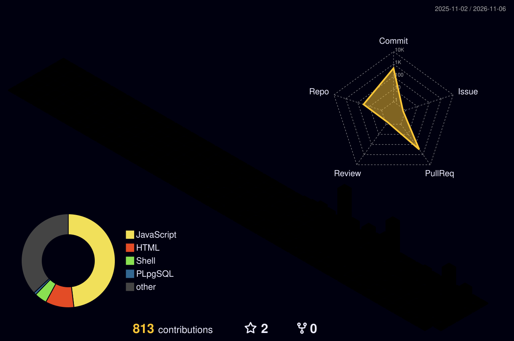

  

  

### Técnico en Desarrollo de Software

Zona 6, Guatemala · Remoto / Híbrido

Técnico en Desarrollo de Software con experiencia práctica construyendo y probando APIs con Node.js, Strapi y Redis. Actualmente colaboro en el desarrollo backend de un sistema de gestión de órdenes (OMS) y en ALBA, una app de salud y adherencia farmacológica, mientras continúo mi formación en Campuslands.

 

  

<h2 align="center">Experiencia y proyectos</h2>

<table align="center">
  <tr>
    <td align="center"><strong>OMS Backend — SoftPlus GT</strong></td>
    <td align="center"><strong>ALBA — Campuslands GT</strong></td>
  </tr>
  <tr>
    <td>
      Desarrollo de backend/API a la medida para un sistema de gestión de órdenes, normalizando la base de datos e implementando validaciones y manejo centralizado de errores con Node.js, Redis y WebSocket en tiempo real. Configuración del entorno y despliegue con Docker, con documentación y testing a la medida de cada servicio.
        
      <strong>Stack:</strong> Node.js · Redis · WebSocket · Docker · Testing
        
      <strong>Experiencia profesional · 2026 – En desarrollo</strong>
    </td>
    <td>
      Colaboro como Dev 7 en un equipo de 10 desarrolladores en una app móvil de salud y adherencia farmacológica para adultos mayores. Participo en el módulo del cuidador, QR y botiquín: alertas, notificaciones push con Firebase Cloud Messaging (FCM), carga de imágenes a Firebase Storage y seguimiento de la adherencia al tratamiento.
        
      <strong>Stack:</strong> Firebase (FCM, Storage) · Node.js
        
      <strong>Experiencia profesional · 2026 – En desarrollo</strong>
    </td>
  </tr>
  <tr>
    <td align="center"><strong>TutorBot</strong></td>
    <td align="center"><strong>Gestión de Parque Vehicular</strong></td>
  </tr>
  <tr>
    <td>
      Automatización de tutorías mediante asignación, validación de identidad y notificaciones automáticas al maestro y materia correspondiente.
        
      <strong>Stack:</strong> n8n · Google AI · Google Sheets · Telegram
        
      <a href="https://github.com/canuxantonio502/automatizacion_tutorbot_n8n">Ver proyecto</a>
    </td>
    <td>
      Sistema de control de estacionamiento para 4 tipos de vehículo (moto, carro, bus y camión) con selección de espacio por cliente.
        
      <strong>Stack:</strong> HTML · CSS · JavaScript
        
      <a href="https://github.com/lemical07/sistema-gestion-parqueo">Ver proyecto</a>
    </td>
  </tr>
</table>

  <strong>Tienda en línea</strong> — Maquetación de una interfaz de tienda online.
   
  <strong>Stack:</strong> HTML · CSS ·
  <a href="https://github.com/lemical07/maquetacion-tienda-online">Ver proyecto</a>

<h2 align="center">Panel de capacidades</h2>

<table align="center">
  <tr>
    <th align="center">Backend</th>
    <th align="center">Frontend</th>
    <th align="center">Bases de datos</th>
    <th align="center">Automatización</th>
    <th align="center">Herramientas</th>
  </tr>
  <tr>
    <td align="center">Node.js</td>
    <td align="center">HTML</td>
    <td align="center">MySQL</td>
    <td align="center">n8n</td>
    <td align="center">Git</td>
  </tr>
  <tr>
    <td align="center">Express</td>
    <td align="center">CSS</td>
    <td align="center">Redis</td>
    <td align="center">Telegram</td>
    <td align="center">GitHub</td>
  </tr>
  <tr>
    <td align="center">Strapi 5</td>
    <td align="center">JavaScript</td>
    <td align="center">—</td>
    <td align="center">Google Sheets</td>
    <td align="center">Docker (básico)</td>
  </tr>
  <tr>
    <td align="center">WebSocket · Postman</td>
    <td align="center">—</td>
    <td align="center">—</td>
    <td align="center">Google AI</td>
    <td align="center">VS Code</td>
  </tr>
</table>

  

<h2 align="center">Formación</h2>

<table align="center">
  <tr>
    <th align="left">Formación académica y complementaria</th>
  </tr>
  <tr>
    <td align="left">
      <strong>Técnico en Desarrollo de Software — Campuslands GT</strong> 
      2026 · Presente 
      Formación en desarrollo de software: frontend, backend, APIs y proyectos reales.
    </td>
  </tr>
  <tr>
    <td align="left">
      <strong>Bachillerato en Ciencias y Letras, Orientación en Electrónica Industrial</strong> 
      2024 · 2025 — Escuela Experimental Villa de los Niños 
      Graduado con honores.
    </td>
  </tr>
  <tr>
    <td align="left">
      <strong>Idiomas</strong> 
      Pocomchí — Materno · Inglés — Intermedio
    </td>
  </tr>
</table>

<h2 align="center">Indicadores</h2>

  
  

  

<h2 align="center">Contribuciones</h2>

  

<h2 align="center">Valor profesional</h2>

<table align="center">
  <tr>
    <td align="center">Comunicación clara y directa: expreso mis ideas con claridad y respeto.</td>
  </tr>
  <tr>
    <td align="center">Perseverancia: no me rindo ante los retos; cumplo mis metas con constancia.</td>
  </tr>
  <tr>
    <td align="center">Adaptabilidad: me adapto con facilidad a entornos, herramientas y proyectos nuevos.</td>
  </tr>
  <tr>
    <td align="center">Aprendizaje continuo: aprendo probando, construyendo y mejorando.</td>
  </tr>
  <tr>
    <td align="center">Sentido del diseño: priorizo interfaces minimalistas, elegantes y coherentes.</td>
  </tr>
  <tr>
    <td align="center">Trabajo en equipo: colaboro con respeto y lealtad, y celebro los logros de mis compañeros.</td>
  </tr>
  <tr>
    <td align="center">Gestión bajo presión: mantengo la calma y la concentración cuando aumenta la exigencia.</td>
  </tr>
</table>

<h2 align="center">Contacto</h2>

  ¿Tienes un proyecto o una oportunidad profesional? Puedes contactarme por cualquiera de estos canales.

  &nbsp;
  &nbsp;
  &nbsp;
  &nbsp;
  &nbsp;
  

